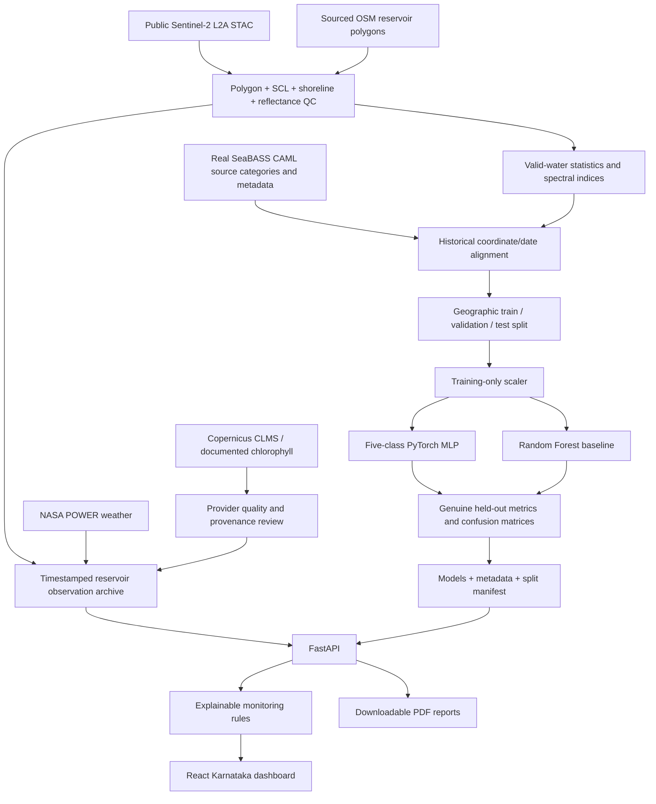

# Architecture

The frontend calls only the same-origin `/api` endpoints. Remote collection and credentialed services run in Python scripts, never in React. The API uses saved real observations for fast and reproducible display. Public, read-only endpoints expose reservoir data, mapped geometry, model status, report downloads and accepted satellite images. There is no unauthenticated mutation/credential endpoint.

The built frontend can be served by FastAPI from `frontend/dist`. Development Vite proxies to the same API. JSON writes are atomic in the collection path. Missing observations produce explicit unavailable states rather than client-side demonstrations or generated values.
