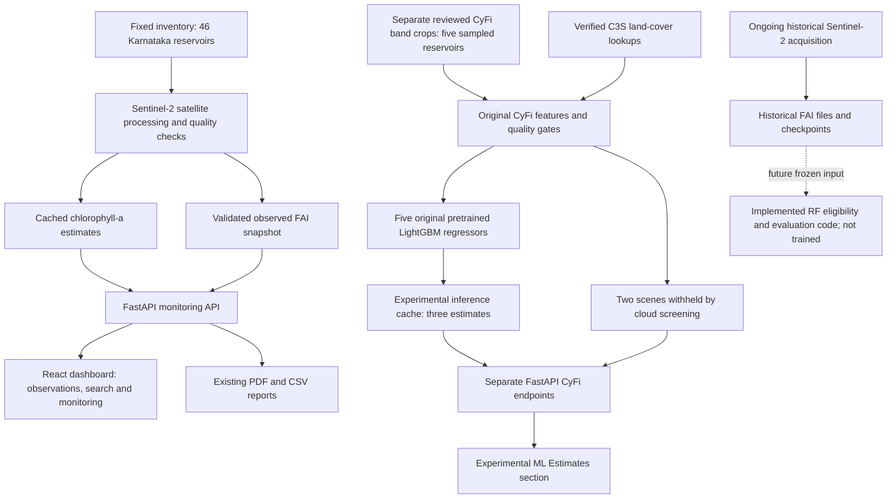

# Current implemented NEERWATCH architecture

The CyFi path has no connection to operational alerts or existing reports. Forty-one reservoirs have no reviewed CyFi inputs in the published snapshot and explicitly return unavailable. The RF code exists, but there is no trained future-FAI model or forecast in this architecture. The existing acquisition process was not restarted or modified.
