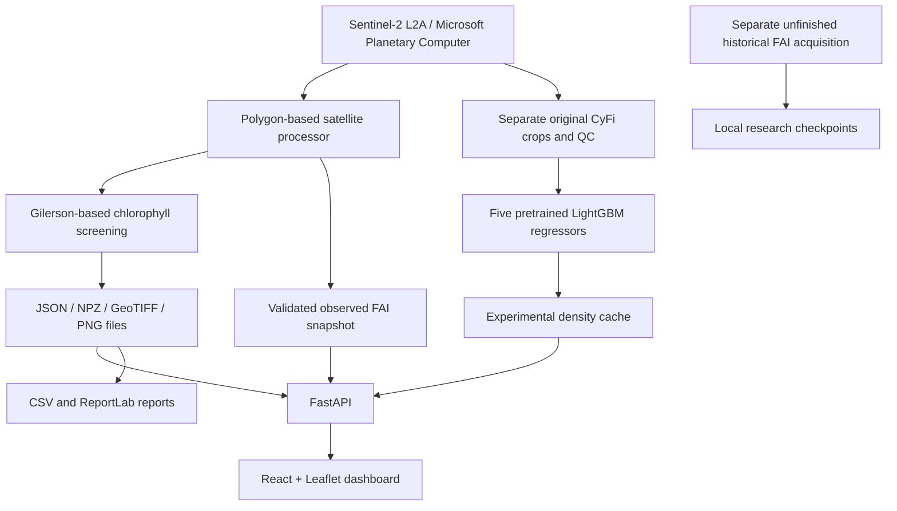

# NEERWATCH: Complete Technical Guide

Prepared from the implementation and stored files on 23 October 2026. Authors: Shriya HR, Sudeeksha V, Shradha Kubhal and Sandya K. Department of Computer Science and Engineering, Dayananda Sagar College of Engineering, Bengaluru, Karnataka, India.

## A. Project overview

**Title:** NEERWATCH: Satellite-Based Algal Indicator Monitoring for Karnataka Reservoirs.

**Problem:** Reservoir observations are difficult to compare when images, dates, methods and quality information are separated. NEERWATCH brings these together for exactly 46 Karnataka reservoirs. Karnataka is the chosen geographic project scope; this does not mean the algorithms have been calibrated there.

The working system displays experimental chlorophyll-a estimates, observed Floating Algae Index (FAI), dated changes, satellite images, maps, downloadable reports and experimental pretrained cyanobacteria density estimates. It supports screening and planning follow-up measurements. It cannot certify water safety or confirm toxicity.

The contribution is traceable integration: each estimate has an acquisition date, source, processing method and quality context. It is not a new satellite instrument, a newly invented chlorophyll algorithm or a newly trained local ML model.

## B. Complete architecture



The frontend is a Vite React application. `frontend/src/main.jsx` contains `App`, `ExperimentalML`, reusable display/chart functions and reservoir interactions. Leaflet provides the map. Browser requests use `/api/...`. FastAPI routes in `backend/main.py` load file-backed state and return JSON or image/PDF/CSV responses. The built frontend is served by FastAPI on port 8010. During development Vite can run separately on port 5180.

There is no production database or model-training server. JSON stores metadata/results, NPZ stores arrays, GeoTIFF preserves a georeferenced chlorophyll layer, and PNG supplies browser images. CyFi has a separate immutable input manifest and prediction cache. The dashboard FAI reader uses a published snapshot, not files being written by the historical acquisition job.

The two processing paths differ. The chlorophyll/FAI path uses a common 60 m projected grid and scaled reflectance. CyFi retains original native-grid, raw-DN feature preprocessing. Do not say that CyFi consumes the 60 m chlorophyll arrays.

## C. Satellite data and indicators

Sentinel-2 Level-2A provides bottom-of-atmosphere imagery processed by the provider with Sen2Cor. STAC scene metadata and raster assets come from Microsoft Planetary Computer. This is not a locally validated aquatic atmospheric correction.

### Chlorophyll-a

`pipeline/sentinel2_chlorophyll.py::gilerson(b05,b04)` implements:

`C = [35.75 × (B05 / B04) − 19.30]^1.124`

B04 is red (approximately 665 nm), B05 is red-edge (approximately 705 nm). The published expression uses a red-edge/NIR-to-red relation; substituting Sentinel-2 bands and L2A reflectance is an experimental screening adaptation. Inputs and the expression base must be positive. Only finite per-pixel values from 1 through 100 µg/L are retained. Values outside that domain are rejected, not clipped. The reservoir value is the median of retained pixels, not the formula evaluated at the mean reflectance.

`pipeline/satellite.py::read_item` uses the reservoir's UTM zone, a 60 m grid and nearest-neighbour resampling. Asset scale/offset metadata is used; defaults are scale 0.0001 and offset −0.1 for processing baseline ≥4, otherwise zero offset. Raw zero is no-data. SCL class 6 identifies water. Water is eroded by approximately 60 m; SCL classes 3, 8, 9 and 10 are dilated by approximately 60 m and excluded. Reflectance validity is checked. The processing requires at least 95% scene footprint, 25 valid pixels and 10% polygon coverage. Same-pass mosaicking is implemented in `pipeline/mosaic.py`; it does not mix arbitrary dates.

At the snapshot, all 46 reservoirs have two stored chlorophyll observations (92 total). Latest values span 16.18–67.65 µg/L; 42 are in the implemented eutrophic screening interval and four in hypereutrophic. These are model-based screening results, not 46 field measurements.

### Floating Algae Index

`pipeline/fai_snapshot.py::build` calculates:

`FAI = B08 − [B04 + (B11 − B04) × (842 − 665)/(1610 − 665)]`

B08 is near infrared (~842 nm); B11 is shortwave infrared (~1610 nm). The red-to-SWIR baseline is subtracted from NIR. FAI is dimensionless; a negative value is valid. It is not µg/L, a toxin concentration or a calibrated biomass measurement. Turbidity, vegetation, mixed pixels and atmosphere can interfere. Water-only masks can omit dense surface scum.

The immutable display snapshot contains 90 QC-approved observations across 45 reservoirs. Varahi remains in the inventory but its two legacy FAI observations lack complete saved SCL provenance and are excluded from comparable FAI history. Varahi's successful CyFi scene does not repair its separate legacy FAI masks.

Absolute chlorophyll change is latest minus earlier. Percentage change is 100 × (latest − earlier)/earlier, with checks for compatible observations and valid denominators. Acquisition time, not download time, dates a result. Neither an increase nor a color alone proves a harmful bloom.

## D. Machine learning

### What is actually implemented

`pipeline/cyfi_inference.py::infer` loads `models/cyfi/model_v0.zip`, verifies its checksum and obtains five saved LightGBM boosters. All five declare a regression objective. They predict a numerical transformed cyanobacteria density, not one of the display-band classes.

LightGBM means Light Gradient Boosting Machine. Gradient boosting builds trees sequentially to improve a loss function: a new tree addresses residual errors/gradients left by the current ensemble. Random Forest instead combines trees trained with randomized samples/features, usually independently. Five saved regressors provide an ensemble; NEERWATCH uses all five original members. We did not create new local folds or retrain them.

CyFi's upstream documentation describes training with field labels from the United States. Our contribution is installing/verifying the pretrained model, acquiring genuine inputs, checking quality and provenance, running inference, caching it and integrating the results. No local MAE, RMSE or R² is available because independent Karnataka reference counts are absent. Passing tests proves software behavior, not biological accuracy.

### Inputs and preprocessing

The point-centred box extends 2 km on each side, approximately 4 km wide. Original asset inputs are AOT, B01–B09, B11, B12, B8A, SCL and WVP (15 assets; no B10). Original raw-DN/native-grid crops are used without silently adding reflectance corrections or clipping. SCL water selection and original cloud rules are retained. The additional geographic review requires at least 95% of SCL water in the crop to lie inside the intended reservoir polygon. Original crop cloud classes 7–10 must be ≤5%; all required numerical features must be finite. Non-water, cloudy, incomplete or incompatible inputs do not produce a displayed estimate.

The exact 30 ordered features are:

`B01_mean, B02_mean, B03_mean, B04_mean, B05_mean, B06_mean, B07_mean, B08_mean, B09_mean, B11_mean, B12_mean, B8A_mean, WVP_mean, AOT_mean, percent_water, green95th, green5th, green_red_ratio, green_blue_ratio, red_blue_ratio, green95th_blue_ratio, green5th_blue_ratio, NDVI_B04, NDVI_B05, NDVI_B06, NDVI_B07, AOT_range, month, days_before_sample, land_cover`.

They describe band means, green percentiles, ratios, normalized differences, water proportion, aerosol range, month, image/sample offset and land cover. In this dated observation application, `days_before_sample=0`; there is no concurrent field sample implied by that setting. The 2020 C3S land-cover raster provides the genuine land-cover lookup.

Each booster returns a log-space value `z_i`. The implemented ensemble is:

`density = round(exp(max(0, mean(z_1,...,z_5))) − 1)`.

The nonnegative transformation is inherited from CyFi; we did not clip the input feature values. The model output is cells/mL: estimated number of cyanobacterial cells per millilitre. It is not a microscopy count. The mean is taken before exponentiation, not after.

Runtime versions, source code, band files, model archive and registry are checked against the reviewed manifest. Source baselines, dates and URLs are preserved. Radiometric transfer and out-of-training-range values remain unresolved: finite inputs and consistent preprocessing do not establish in-distribution inputs. No local calibration or invented correction is applied. The UI calls the result experimental and retains compatibility caveats in quality/provenance details.

### Current coverage

There are 32 completed experimental estimates and 14 withheld reservoirs. Eight original values were preserved; the completed first acquisition pass added 24. A second acquisition pass was not started after the backup-priority instruction. Not assessed means no input approved in the bounded search, not no algae.

## E. Cyanobacteria reference bands

| Numerical estimate (cells/mL) | Badge |
|---|---|
| 0 ≤ x < 20,000 | Lower count band, green |
| 20,000 ≤ x < 100,000 | Moderate count band, yellow |
| 100,000 ≤ x ≤ 10,000,000 | High count band, red |
| x > 10,000,000 | Very high count band, dark red |
| Missing, negative, nonfinite or non-complete | Not assessed, grey |

`backend/cyfi_reference.py::reference_band` owns these exact boundaries. 10,000,000 is included in High. Zero receives Lower only if it is a completed, valid estimate. Historical WHO guidance summarized by EPA supports the 20,000/100,000 reference values; the 10-million split is explicitly a project display extension. These are not current WHO operational classes, Karnataka legal limits or validated health-risk assessments. Current WHO guidance considers other evidence, including biovolume, chlorophyll-a, scums and toxins. CyFi is isolated from existing operational alert and PDF calculations.

## F. Historical FAI and Random Forest

The separate historical acquisition targets January 2022 through October 2026 for the same 46 reservoirs. At inspection, 10,417 per-scene status files existed: 5,220 marked valid and 5,197 rejected/error. Valid records were 1,802 in 2022, 1,973 in 2023 and 1,445 in 2024; this count is from current files, not the older progress report. No process was running. These files remain local and were not changed. Catalogue completion does not equal processing completion. Later years and complete seasonal/partition checks remain outstanding.

`pipeline/fai_regression.py` is offline preparation, not a deployed model. It creates a future-FAI target near 10 days, allowing actual observations 7–13 days later. Features are current FAI, previous FAI, age of previous observation and sine/cosine day-of-year. A previous gap above 30 days is excluded. Global chronological cutoffs are 1 January 2025 and 1 January 2026; 13-day target windows are purged across boundaries and duplicate reservoir/target dates removed. Persistence predicts current FAI at the target date.

Training is gated: all five years, at least 300/100/100 train/validation/test targets, at least 20 reservoirs and all four quarters per split. The prepared RandomForestRegressor configuration is 500 trees, maximum depth 12, minimum leaf size 10 and random seed 42. It can report MAE/RMSE/R² and reservoir/season breakdowns, but no future-FAI model has been trained or deployed in this work. Do not confuse legacy classification artifacts in `models/` with a trained FAI regressor or with the active CyFi path.

## G. Source code map

| Actual path | Important functions and role |
|---|---|
| `data/reservoirs.json` | Exact inventory of 46 named reservoirs |
| `data/boundaries/` | Reservoir geometry files |
| `pipeline/satellite.py` | `search`, `read_item`, `save_rgb`: scene access, projection, scaling, masks and imagery |
| `pipeline/mosaic.py` | `observations`: groups compatible same-pass tiles |
| `pipeline/sentinel2_chlorophyll.py` | `gilerson`, `process`, `start`, `get_status`: screening calculation and jobs |
| `pipeline/fai_snapshot.py` | `build`: reconstructs QC masks and writes frozen FAI snapshot |
| `backend/fai.py` | `observed`: separates comparable and legacy rows; forecast is None |
| `pipeline/cyfi_inference.py` | `infer`: verifies and executes original five-model ensemble |
| `backend/cyfi.py` | `context`, `key`, `available`, `present`, `compute`, `start`: eligibility, caching, worker and API presentation |
| `backend/cyfi_reference.py` | `reference_band`: display-only threshold mapping |
| `backend/main.py` | FastAPI routes, errors, file responses and frontend serving |
| `backend/active.py` | `monitoring`: active stored Sentinel-2 monitoring state |
| `backend/monitoring.py` | `summary`: reservoir detail and independent observed FAI |
| `backend/epa.py` | `classify`: chlorophyll trophic screening |
| `backend/reports.py` | `report`: ReportLab reservoir PDF |
| `frontend/src/main.jsx` | Main interface, reservoir selection, FAI and experimental ML display |
| `frontend/src/style.css` | Layout and badge styles |
| `pipeline/fai_regression.py` | `load`, `pairs`, `split`, `eligibility`, `metrics`, `run`: future experiment preparation |
| `research/pretrained-review/poc/expand_coverage.py` | Separate bounded CyFi acquisition/checkpoints |
| `tests/` | Numerical, API, QC, preservation and cache regression tests |

Core endpoints: GET `/api/health`, `/api/reservoirs`, `/api/reservoirs/{id}`, `/api/reservoirs/{id}/cyfi`, `/api/reservoirs/{id}/processing`; POST `/api/reservoirs/{id}/cyfi`, `/api/reservoirs/{id}/process-sentinel2`; GET `/api/reservoirs/{id}/report.pdf`, `/api/chlorophyll-review.csv` and Sentinel-2 image/raster routes. CyFi responses include status, density, unit, acquisition date, reference badge, quality and provenance.

## H. Testing and results

Commands: `.venv/bin/python -m pytest tests -q` and `npm --prefix frontend run build`.

Latest completed suite: **111 passed, 1 Starlette/httpx deprecation warning, 34.49 s**. Frontend production build passed. `/api/health` returned online after restart. Tests include actual original-model execution, feature/file hashes, preserving the original eight values, exact reference boundaries, missing/invalid values, all-46 registry consistency, independent reports and alerts, and no fabricated forecast.

The previous live browser check verified KRS Lower, Kabini Moderate and rejected-input Not assessed. Browser access became disabled afterward; newly expanded reservoirs have API/data verification, not a fresh visual verification claim. Local deployment is tested; public Vercel deployment is not verified by this work.

Full current approved/withheld results are appended below. The GitHub source backup excludes credentials, runtimes and large raw caches. A fresh clone supports cached display with the normal application dependencies, but genuine recomputation requires the separately installed CyFi runtime, upstream source and raw data/land-cover assets. Do not delete this local workspace before the demonstration.

## I. Faculty viva: 40 questions and answers

1. **What does NEERWATCH do?** It displays dated satellite-derived algal indicators and experimental cyanobacteria estimates for 46 Karnataka reservoirs.
2. **Why Karnataka?** It is our defined regional project scope, allowing a consistent reservoir inventory and focused demonstration.
3. **What is your main contribution?** Integrating acquisition, quality checks, calculations, provenance, model inference and a usable dashboard.
4. **Did you invent the chlorophyll formula?** No. We implemented a published Gilerson-based expression as a Sentinel-2 screening adaptation.
5. **What is Sentinel-2?** A multispectral Earth-observation satellite mission that measures reflected light in several wavelength bands.
6. **What is Level-2A?** Provider-processed bottom-of-atmosphere imagery with scene classification; it is not automatically a field-validated aquatic product.
7. **Where do images come from?** Microsoft Planetary Computer's Sentinel-2 L2A collection.
8. **How is chlorophyll computed?** Apply `[35.75(B05/B04)−19.30]^1.124` to valid pixels, reject values outside the screening domain, then take the median.
9. **What unit does chlorophyll use?** Micrograms per litre, shown as µg/L.
10. **What is FAI?** A dimensionless NIR reflectance departure from a red-to-SWIR baseline, associated with floating surface algae.
11. **Can FAI be negative?** Yes. Negative spectral departures are valid and are not replaced with zero.
12. **Why two indicators?** Chlorophyll screening and FAI describe different spectral relationships; neither alone identifies toxicity.
13. **What is cloud masking?** Excluding pixels identified as clouds, shadows or nearby contaminated areas before calculating an indicator.
14. **Why shoreline erosion?** To reduce mixed land/water pixels near reservoir boundaries.
15. **Why a 60 m grid?** It is the implemented common analysis grid for consistent alignment; it sacrifices fine detail and is not native resolution for every band.
16. **Why use a median?** It is less influenced by extreme retained pixels than a mean, although it cannot remove all systematic bias.
17. **What is regression?** Prediction of a numerical quantity, such as estimated cells per millilitre.
18. **What is classification?** Prediction of a discrete label. Our count badges are deterministic mappings after regression, not a separately trained classifier.
19. **Why LightGBM?** CyFi provides an existing inspectable pretrained numerical-density model compatible with Sentinel-2 features; we did not prove it is best for Karnataka.
20. **Explain gradient boosting.** Trees are added sequentially to improve the current prediction by reducing a loss function.
21. **How is Random Forest different?** It averages randomized trees; boosting adds trees sequentially to correct errors.
22. **Did you train CyFi?** No. We use five original pretrained regressors and did not retrain them.
23. **What is a pretrained model?** A model whose parameters were learned previously; we load them to predict from new inputs.
24. **Why five models?** The supplied artifact contains five regression members, and the original inference combines them as an ensemble.
25. **How are outputs combined?** Average their log-space outputs, apply the original nonnegative bound and expm1 transform, then round.
26. **What are the independent variables?** Thirty ordered spectral and contextual features, including band means, ratios, month and land cover.
27. **What is the dependent variable?** Cyanobacteria density, represented in transformed space by the saved regressors and reported in cells/mL.
28. **What does 16,652 cells/mL mean?** KRS's model-estimated cyanobacteria density for its dated image, not a laboratory count.
29. **How do you know predictions are accurate?** We verify execution and provenance, but cannot claim Karnataka accuracy without independent local measurements.
30. **Why are some reservoirs Not assessed?** Their tested inputs failed QC or no reviewed usable observation was found; this does not mean zero cyanobacteria.
31. **Can it detect toxins?** No. Cell counts and spectral indicators do not establish toxin presence or concentration.
32. **Is green safe?** No. It is a numerical reference band, not a safety certificate.
33. **Where do thresholds come from?** Historical WHO-derived references summarized by EPA; the 10-million split is our documented display extension.
34. **Does CyFi trigger alerts?** No. Experimental estimates do not change operational alerts or PDF report calculations.
35. **Can it forecast ten days ahead?** Not currently. Future-FAI code is prepared, but no forecasting model is trained or deployed.
36. **What if imagery is cloudy?** The scene is rejected and other bounded candidates may be checked; a bad scene is not forced into a prediction.
37. **How do React and FastAPI communicate?** The browser sends HTTP requests to `/api` routes and renders returned JSON and file URLs.
38. **What do 111 tests prove?** Specified software behavior and regression checks, not retrieval accuracy against field measurements.
39. **What are the main limitations?** No local validation, atmospheric/radiometric transfer, mixed pixels, cloud gaps and unequal reservoir support.
40. **How would you improve it?** Collect independent Karnataka field measurements, validate by lake/date, improve aquatic correction and evaluate forecasting only after complete temporal data exist.

## J. Presentation preparation

### Two-minute explanation

NEERWATCH is a satellite-based monitoring dashboard for 46 Karnataka reservoirs. The problem we address is that an observation is useful only when we know its date, source and processing quality. Our system obtains Sentinel-2 imagery and screens it with reservoir boundaries and water/cloud masks. It calculates an experimental chlorophyll-a concentration and a dimensionless Floating Algae Index. Users can compare dated observations, view satellite and chlorophyll maps, and download reports.

We also integrated CyFi, an existing pretrained LightGBM regression ensemble. We did not train it ourselves. It processes genuine Sentinel-2 inputs and estimates cyanobacteria density. At this snapshot, 32 reservoirs have experimental estimates and 14 are not assessed because their inputs were not approved. Reference colors describe numerical ranges, not health safety. We preserve dates and sources and do not let experimental ML results change official-looking alerts.

Our contribution is the implemented, tested workflow and clear separation of observations, empirical estimates and pretrained model outputs. We have 111 passing backend tests, but these do not prove biological accuracy. Local field measurements are still needed. A ten-day FAI forecasting pipeline is prepared, not trained or deployed.

### Five-minute walkthrough

- Minute 1: Show the 46-reservoir scope, search and map. State the problem and contribution.
- Minute 2: Select KRS. Explain its two chlorophyll dates, concentration, percentage change, RGB and concentration map. Show acquisition rather than download date.
- Minute 3: Show observed FAI, its dimensionless unit and valid negative value. Explain the difference from chlorophyll.
- Minute 4: Show KRS's 16,652 cells/mL and model provenance. Select a new supported reservoir such as Varahi; explain that its CyFi result does not repair its legacy FAI QC. Select a rejected reservoir to show Not assessed.
- Minute 5: Open key code and test result. State that models are pretrained, local accuracy is unknown, and forecasting is unfinished.

### Files to open in VS Code

Open `frontend/src/main.jsx` at `ExperimentalML`, `backend/main.py` at `/cyfi`, `pipeline/cyfi_inference.py` at `infer`, `backend/cyfi_reference.py` at `reference_band`, and `pipeline/sentinel2_chlorophyll.py` at `gilerson`. For FAI, open `pipeline/fai_snapshot.py`. For proof of stored model output, open `data/cyfi/predictions/krs.json`. Show the model archive, not a claim that we trained a model. Use `tests/test_cyfi.py` and the latest test log to explain verification.

### Launch on this existing laptop

```sh
cd /Users/shriyahr/Documents/ChatGPT/Major/NEERWATCH
npm --prefix frontend run build
.venv/bin/python -m uvicorn backend.main:app --host 127.0.0.1 --port 8010
```

Open http://127.0.0.1:8010/. If that port is already serving the app, use the running server instead of launching a second one. Keep the terminal open. For a fresh setup, use the project's full `requirements.txt`; the remote `pyproject.toml` is not a complete reproduction of the research runtime. Cached estimates make the demo independent of new satellite downloads. Do not click processing unnecessarily during the presentation.

### Five limitations to state honestly

1. No independent Karnataka field validation of the displayed estimates.
2. L2A aquatic correction and CyFi radiometric transfer remain imperfect/unresolved.
3. Cloud cover, shorelines and mixed water/vegetation pixels limit useful imagery.
4. Only 32 of 46 reservoirs currently have approved experimental CyFi inputs.
5. No deployed future-FAI forecasting model or toxin detector.

### Sources

Gilerson et al., Optics Express, 2010, doi:10.1364/OE.18.024109. Hu, Remote Sensing of Environment, 2009, doi:10.1016/j.rse.2009.05.012. DrivenData CyFi: https://github.com/drivendataorg/cyfi (MIT). Ke et al., LightGBM, NeurIPS 2017. EPA historical WHO summary: https://www.epa.gov/habs/world-health-organization-who-1999-guideline-values-cyanobacteria-freshwater. These sources support methods/background, not Karnataka performance.

## Appendix: actual CyFi snapshot

| Reservoir | cells/mL | Acquisition | Status / reason |
|---|---:|---|---|
| KRS | 16652.0 | 2026-10-12 | complete |
| Bhadra | 16710.0 | 2026-10-12 | complete |
| Tungabhadra | 7073.0 | 2026-10-12 | complete |
| Supa | 7105.0 | 2026-10-20 | complete |
| Varahi | 16001.0 | 2026-10-12 | complete |
| Vani Vilasa Sagara | — | 2026-09-22 | No approved CyFi input after 8 acquisitions checked in the 2026-06-25–2026-10-23 window. Cloud fraction 20.3926% exceeds original 5% limit; Cloud fraction 12.9277% exceeds original 5% limit; Cloud fraction 100.0000% exceeds original 5% limit; Cloud fraction 19.4809% exceeds original 5% limit; Cloud fraction 35.5798% exceeds original 5% limit; Cloud fraction 7.7909% exceeds original 5% limit; Cloud fraction 8.5849% exceeds original 5% limit |
| Kabini | 92348.0 | 2026-10-12 | complete |
| Harangi | 35562.0 | 2026-10-12 | complete |
| Hemavathi | 56982.0 | 2026-10-12 | complete |
| Almatti | 39250.0 | 2026-09-27 | complete |
| Linganamakki | 20834.0 | 2026-10-12 | complete |
| Markonahalli | — | 2026-10-07 | No approved CyFi input after 8 acquisitions checked in the 2026-06-25–2026-10-23 window. Cloud fraction 58.4500% exceeds original 5% limit; Cloud fraction 43.3571% exceeds original 5% limit; Cloud fraction 100.0000% exceeds original 5% limit; Cloud fraction 99.4952% exceeds original 5% limit; Cloud fraction 10.9325% exceeds original 5% limit; Cloud fraction 27.2350% exceeds original 5% limit |
| Yagachi | 12934.0 | 2026-09-27 | complete |
| Hidkal | 48623.0 | 2026-10-20 | complete |
| Nugu | 46936.0 | 2026-09-27 | complete |
| Kadra | — |  | No approved CyFi input after 0 acquisitions checked in the 2026-06-25–2026-10-23 window. Invalid boundary or registry point outside polygon; no replacement point guessed |
| Basava Sagara | 21437.0 | 2026-10-12 | complete |
| Malaprabha (Renuka Sagara) | — | 2026-10-07 | No approved CyFi input after 8 acquisitions checked in the 2026-06-25–2026-10-23 window. Cloud fraction 73.3596% exceeds original 5% limit; Cloud fraction 5.2103% exceeds original 5% limit; Cloud fraction 100.0000% exceeds original 5% limit; Cloud fraction 7.1162% exceeds original 5% limit; Only 89.1334% of SCL water belongs to reservoir polygon; minimum 95%; Cloud fraction 6.1409% exceeds original 5% limit; Only 90.0660% of SCL water belongs to reservoir polygon; minimum 95%; Only 90.6423% of SCL water belongs to reservoir polygon; minimum 95% |
| Gerusoppa | 18648.0 | 2026-10-20 | complete |
| Kodasalli | — | 2026-09-25 | No approved CyFi input after 8 acquisitions checked in the 2026-06-25–2026-10-23 window. Original feature QC missing/nonfinite: B08_mean, NDVI_B04, NDVI_B05, NDVI_B06, NDVI_B07; Cloud fraction 100.0000% exceeds original 5% limit; Cloud fraction 95.0002% exceeds original 5% limit; Cloud fraction 14.4500% exceeds original 5% limit |
| Karanja | 35048.0 | 2026-10-12 | complete |
| Kanva | — | 2026-09-24 | No approved CyFi input after 8 acquisitions checked in the 2026-06-25–2026-10-23 window. Cloud fraction 30.5632% exceeds original 5% limit; Cloud fraction 17.6821% exceeds original 5% limit; Cloud fraction 100.0000% exceeds original 5% limit; Cloud fraction 15.3955% exceeds original 5% limit |
| Manchanabele | 46535.0 | 2026-10-14 | complete |
| Suvarnavathy | — | 2026-09-24 | No approved CyFi input after 8 acquisitions checked in the 2026-06-25–2026-10-23 window. Cloud fraction 24.3054% exceeds original 5% limit; Cloud fraction 19.6341% exceeds original 5% limit; Cloud fraction 75.2506% exceeds original 5% limit; Cloud fraction 99.9830% exceeds original 5% limit; Cloud fraction 56.7789% exceeds original 5% limit; Cloud fraction 66.6748% exceeds original 5% limit; Cloud fraction 100.0000% exceeds original 5% limit |
| Taraka | 30757.0 | 2026-10-12 | complete |
| Votehole | 21920.0 | 2026-10-12 | complete |
| Bennethora | — | 2026-09-22 | No approved CyFi input after 8 acquisitions checked in the 2026-06-25–2026-10-23 window. Cloud fraction 22.3727% exceeds original 5% limit; Cloud fraction 6.7082% exceeds original 5% limit; Cloud fraction 100.0000% exceeds original 5% limit; Cloud fraction 12.2573% exceeds original 5% limit; Cloud fraction 21.7642% exceeds original 5% limit; Cloud fraction 18.9486% exceeds original 5% limit; Cloud fraction 23.2348% exceeds original 5% limit |
| Chandrampalli | 23504.0 | 2026-10-12 | complete |
| Dharma | 18076.0 | 2026-10-09 | complete |
| Upper Tunga | 40367.0 | 2026-10-12 | complete |
| Chikkahole | 141013.0 | 2026-10-14 | complete |
| Chiklihole | 95040.0 | 2026-10-12 | complete |
| Hattikuni | 560209.0 | 2026-10-12 | complete |
| Narihalla | 37714.0 | 2026-09-27 | complete |
| Upper Mullamari | 201497.0 | 2026-10-12 | complete |
| Lower Mullamari | — | 2026-09-22 | No approved CyFi input after 8 acquisitions checked in the 2026-06-25–2026-10-23 window. Cloud fraction 8.4836% exceeds original 5% limit; Cloud fraction 18.7435% exceeds original 5% limit; Cloud fraction 100.0000% exceeds original 5% limit; Cloud fraction 99.9223% exceeds original 5% limit; Cloud fraction 29.4402% exceeds original 5% limit; Cloud fraction 17.8383% exceeds original 5% limit; Cloud fraction 16.1009% exceeds original 5% limit |
| Gundal | — | 2026-09-24 | No approved CyFi input after 8 acquisitions checked in the 2026-06-25–2026-10-23 window. Cloud fraction 86.7093% exceeds original 5% limit; Cloud fraction 40.8940% exceeds original 5% limit; Cloud fraction 100.0000% exceeds original 5% limit; Cloud fraction 9.0621% exceeds original 5% limit; Cloud fraction 39.9210% exceeds original 5% limit |
| Gandorinala | 65716.0 | 2026-10-12 | complete |
| Maskinala | 181883.0 | 2026-10-12 | complete |
| Chulkinala | 261880.0 | 2026-10-12 | complete |
| Harinala | — | 2026-09-25 | No approved CyFi input after 8 acquisitions checked in the 2026-06-25–2026-10-23 window. Cloud fraction 14.8957% exceeds original 5% limit; Cloud fraction 8.2176% exceeds original 5% limit; Cloud fraction 14.5863% exceeds original 5% limit; Cloud fraction 37.2392% exceeds original 5% limit; Cloud fraction 65.4588% exceeds original 5% limit; Cloud fraction 7.9107% exceeds original 5% limit; Cloud fraction 58.1446% exceeds original 5% limit; Cloud fraction 6.8117% exceeds original 5% limit |
| Hirehalla | — | 2026-09-22 | No approved CyFi input after 8 acquisitions checked in the 2026-06-25–2026-10-23 window. Cloud fraction 11.7758% exceeds original 5% limit; Cloud fraction 9.9647% exceeds original 5% limit; Cloud fraction 100.0000% exceeds original 5% limit; Cloud fraction 11.5258% exceeds original 5% limit; Cloud fraction 12.9497% exceeds original 5% limit; Cloud fraction 45.8975% exceeds original 5% limit; Cloud fraction 6.9184% exceeds original 5% limit; Cloud fraction 92.4689% exceeds original 5% limit |
| Uduthorehalla | — | 2026-09-26 | No approved CyFi input after 8 acquisitions checked in the 2026-06-25–2026-10-23 window. Cloud fraction 18.1973% exceeds original 5% limit; Cloud fraction 6.5673% exceeds original 5% limit; Cloud fraction 100.0000% exceeds original 5% limit; Only 0.0000% of SCL water belongs to reservoir polygon; minimum 95%; Cloud fraction 80.5272% exceeds original 5% limit |
| Jambhadhahalla | 37648.0 | 2026-10-12 | complete |
| Tattihalla | — | 2026-10-07 | No approved CyFi input after 8 acquisitions checked in the 2026-06-25–2026-10-23 window. Cloud fraction 6.8174% exceeds original 5% limit; Cloud fraction 7.4060% exceeds original 5% limit; Cloud fraction 100.0000% exceeds original 5% limit; Cloud fraction 68.7602% exceeds original 5% limit; Cloud fraction 6.4110% exceeds original 5% limit; Cloud fraction 6.3593% exceeds original 5% limit |
| Savehaklu | 14499.0 | 2026-10-12 | complete |
