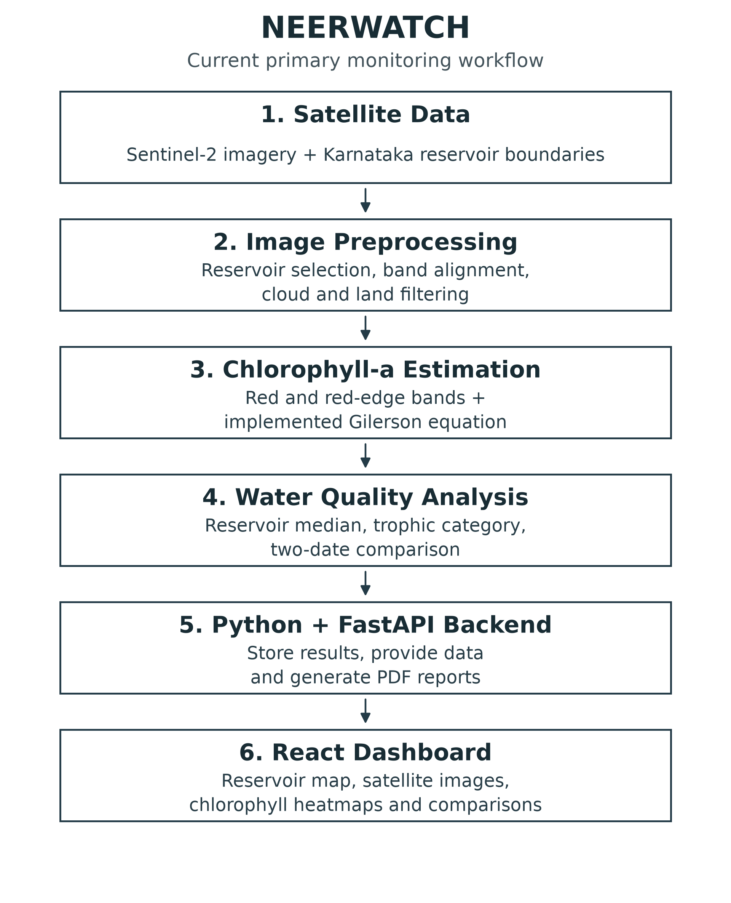
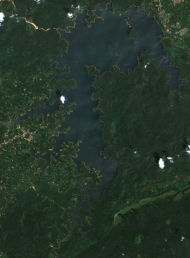
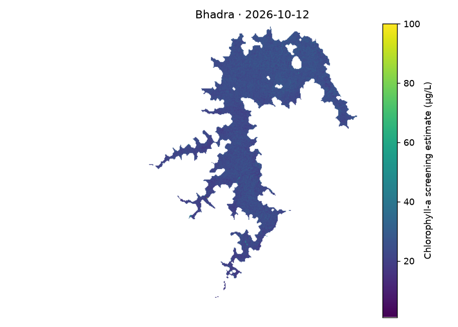

# NEERWATCH

Project context for research-paper preparation | Verified snapshot: 22 October 2026

> Purpose: a factual handover for the teammate writing the IEEE paper. This document describes the current primary empirical monitoring workflow and discloses the additional legacy code path. It does not replace or edit the existing research paper.

## 1. Project overview

Project title: NEERWATCH - Satellite-Based Chlorophyll-a Estimation and Temporal Monitoring of Karnataka Reservoirs.

Problem addressed: reservoir observations can be difficult to compare when satellite images are cloudy, dates differ or data sources are unclear. The project brings satellite-derived chlorophyll-a estimates, their acquisition dates and their supporting images into one reservoir dashboard.

Why Karnataka: the project is explicitly scoped to Karnataka reservoirs, as reflected in its registry, stored boundaries and interface. A formal comparative study explaining why Karnataka was selected over other states is not present in the inspected implementation; do not invent one. The displayed reservoirs are selected by available boundaries and usable observations, not by a statewide statistical sampling plan.

Main objective: provide traceable chlorophyll-a screening estimates and show changes between two compatible satellite observation dates. The system currently retrieves Sentinel-2 data, filters unsuitable pixels, applies a fixed empirical equation, calculates reservoir medians and trophic reference categories, and presents maps, images, comparisons and downloadable reports.

## 2. Existing technologies

| Technology | Actual role |
| --- | --- |
| Python | Runs satellite processing, numerical calculations and backend reporting. |
| Sentinel-2 Level-2A | Provides spectral imagery and scene-classification data. |
| FastAPI | Provides reservoir, boundary, imagery, CSV, processing-status and PDF routes. |
| React | Displays the reservoir dashboard and handles user selection and refresh requests. |
| Leaflet | Draws reservoir polygons and map markers; supports selection and highlighting. |
| Essential libraries | Rasterio: grids and GeoTIFF; Shapely/PyProj: geometry and coordinates; NumPy/SciPy: calculations and masks; Pillow/Matplotlib: images; HTTPX: retrieval; ReportLab: PDF reports. |

> Implementation evidence: pipeline/satellite.py:24-105; pipeline/sentinel2_chlorophyll.py:39-138; backend/main.py:15-54,68-90; backend/reports.py:18-56; frontend/src/main.jsx:1-27,40-74.

## 3. Dataset

Satellite source: Copernicus Sentinel-2 Level-2A imagery accessed through the Microsoft Planetary Computer catalog and its raster assets. The primary concentration is calculated from the saved Sentinel-2 spectral arrays; it is not copied from Sentinel-3 or from another reservoir.

Boundaries: project water polygons come from OpenStreetMap with retained source links and ODbL attribution. Government dam-register records support identity checks where stored; they are not the source of the water polygons. Project checks cover polygon validity, location and provenance, but do not make these boundaries authoritative surveyed shorelines.

| Verified item | Current saved snapshot |
| --- | --- |
| Operational reservoir entries | 46 published reservoirs |
| Accepted satellite observations | 92 reservoir-date records: two compatible dates per reservoir |
| Acquisition-date extent | 9 September 2026 to 20 October 2026 across the paired records |
| Distinct stored item identifiers | 56 scene/composite IDs across the 92 records; scenes can be shared |
| Latest concentration range | 16.18 to 67.65 µg/L |
| Freshness meaning | Most recent accepted saved observation, not a promise of the newest available image today |

The 92 records are reservoir-date summaries, not 92 independent satellite acquisitions or field measurements. No new imagery was acquired to prepare this context document.

### Operational reservoir names

KRS; Bhadra; Tungabhadra; Supa; Varahi; Vani Vilasa Sagara; Kabini; Harangi; Hemavathi; Almatti; Linganamakki; Markonahalli; Yagachi; Hidkal; Nugu; Kadra; Basava Sagara; Malaprabha (Renuka Sagara); Gerusoppa; Kodasalli; Karanja; Kanva; Manchanabele; Suvarnavathy; Taraka; Votehole; Bennethora; Chandrampalli; Dharma; Upper Tunga; Chikkahole; Chiklihole; Hattikuni; Narihalla; Upper Mullamari; Lower Mullamari; Gundal; Gandorinala; Maskinala; Chulkinala; Harinala; Hirehalla; Uduthorehalla; Jambhadhahalla; Tattihalla; Savehaklu.

### What is stored

- JSON: reservoir registry, observation dates and values, history, processing jobs, source information and quality statistics.

- NPZ: compressed spectral arrays, polygon and valid-pixel masks, and calculated chlorophyll arrays. SCL and tile-ownership arrays are retained where available; Varahi has the exceptions described in Section 7.

- PNG: true-colour images and chlorophyll heatmaps. GeoTIFF: chlorophyll rasters with map coordinates. CSV and per-reservoir PDFs are generated through backend routes.

Basava Sagara and Malaprabha use saved same-pass mosaics to cover their reservoir areas. Tiles are grouped by date, satellite, orbit and processing baseline, with no more than five minutes between timestamps; imagery from different days is not merged.

> Evidence: data/reservoirs.json; data/boundaries/{id}.geojson; data/sentinel2/{id}/latest.json and history.json; pipeline/mosaic.py:6-25; backend/readiness.py:8-44. Snapshot values were re-read from current files for this handover.

## 4. Methodology

### 1. Satellite image acquisition

The processor searches the Sentinel-2 Level-2A catalog over a 60-day window and examines the newest observations first. If an image does not pass the checks, it tries earlier observations. Compatible same-pass tiles can be combined when one tile does not cover enough of the reservoir; this is spatial joining, not a future forecast.

### 2. Reservoir area selection

A stored water polygon identifies the reservoir area to analyse. The code rejects invalid or empty geometry and uses the polygon to limit the water-quality calculation. A scene footprint must cover at least 95% of the polygon; mosaics also require at least 95% actual data-footprint coverage.

### 3. Spatial alignment

The bands are placed on one 60 m grid in a UTM coordinate system chosen from the reservoir location. The code uses nearest-neighbour resampling so the band arrays and reservoir mask share cell positions. This 60 m analysis spacing is different from the native 10 m red-band and 20 m red-edge-band resolution.

### 4. Cloud, shadow and land masking

The Scene Classification Layer, or SCL, identifies candidate water cells using class 6. The code removes one analysis pixel from the water edge and expands the shadow/cloud/cirrus exclusions, classes 3, 8, 9 and 10, by one pixel. Other land and non-water classes are excluded; at the 60 m grid these are one-step shoreline and cloud buffers.

### 5. Red and red-edge band extraction

The estimator uses B04, the red band, and B05, the red-edge band. Raw values are converted to reflectance with a scale and additive offset before their ratio is calculated; the current code prefers asset metadata and provides a processing-baseline fallback. All six extracted bands must be finite, positive and no greater than 1 for a pixel to remain valid.

> Reflectance conversion: reflectance = scale × raw pixel value + offset. Raw zero pixels are missing data. Complete conversion metadata is retained for 90 observations; Varahi’s two older records lack that metadata and cannot support the same provenance claim.

> Evidence: pipeline/satellite.py:27-40,43-105; pipeline/features.py:6,19-31; pipeline/mosaic.py:6-25; pipeline/sentinel2_chlorophyll.py:65-86. The 60-day newest-valid policy is implemented, but freshness for every reservoir was not re-established through new processing for this document.

## 4. Methodology - continued

### 6. Chlorophyll-a estimation

The code calculates a chlorophyll-a screening estimate for each accepted pixel using the implemented Gilerson-based expression below. It uses fixed coefficients rather than a trained chlorophyll regression model. Because provider land-oriented surface reflectance is used as an approximation to aquatic reflectance, the result is experimental and may be biased.

C = (35.75 × (B05 / B04) - 19.30)^1.124, with C reported in µg/L.

Here B04 and B05 mean the scaled reflectances, not RGB display colours or unscaled raw values. Both reflectances and the expression inside the power must be positive.

### 7. Quality checks and reservoir median

Non-finite estimates and estimates outside 1-100 µg/L are removed rather than forced to a limit. An observation must retain at least 25 valid pixels and at least 10% of all reservoir-polygon cells. The reported reservoir value is the median of the remaining pixel estimates, so it may describe only part of the reservoir.

### 8. Trophic classification

The backend assigns a trophic screening category using the EPA reference intervals below. A missing, negative or non-finite concentration receives no category. These are transferred reference bands applied to unvalidated estimates, not Karnataka regulatory or drinking-water safety classifications.

| Category | Chlorophyll-a reference interval |
| --- | --- |
| Oligotrophic | C ≤ 2 µg/L |
| Mesotrophic | 2 < C ≤ 7 µg/L |
| Eutrophic | 7 < C ≤ 30 µg/L |
| Hypereutrophic | C > 30 µg/L |

### 9. Comparison of two observation dates

The backend chooses an earlier observation from a different calendar date with compatible method and processing settings. It calculates absolute change as C_latest - C_earlier, and percentage change as 100 × (C_latest - C_earlier) / C_earlier when the earlier value is positive. The sign indicates increasing or decreasing estimates; it does not predict the next seven days or prove a harmful bloom.

### 10. Dashboard, heatmaps and reports

React displays the dated values, reservoir map, true-colour image, chlorophyll heatmap and comparison table. FastAPI provides the saved data and downloads, while ReportLab creates the per-reservoir PDF report. A manual refresh can start background processing and show its status or specific failure reason.

> Evidence: pipeline/sentinel2_chlorophyll.py:39-44,87-108,119-138; backend/epa.py:1-6; backend/active.py:6-15; backend/readiness.py:8-10; backend/reports.py:18-56; frontend/src/main.jsx:49-74.

## 5. Current system architecture

The diagram shows the main empirical workflow at a high level. The backend runs the processing and analysis as well as storing and serving their results; the boxes describe responsibilities, not six separate deployed services. Analysis reads the stored observations, and a manual processing request can update them.

The additional legacy severity-classification path is disclosed in Section 7. It is intentionally omitted from this simple primary-workflow diagram, which does not claim to show every internal backend function.

> Implementation: Python handles preprocessing, empirical estimation and analysis; FastAPI exposes the results; React and Leaflet present them. Storage is file-based. No invented database, cloud deployment, trained chlorophyll regressor or forecasting stage is included.

## 6. Verified saved results

The current snapshot contains 46 operational reservoir entries and 92 paired reservoir-date observations. Latest estimates range from 16.18 to 67.65 µg/L. The reference categories are 42 eutrophic and four hypereutrophic; 20 reservoirs show an increase between their two dates and 26 show a decrease.

The table gives representative saved results. All dates are in 2026; values are rounded to two decimals for presentation, while changes are calculated from the unrounded stored values.

| Reservoir | Earlier | Latest | Earlier C | Latest C | Change % | Class |
| --- | --- | --- | --- | --- | --- | --- |
| KRS | 10-09 | 10-12 | 25.15 | 24.72 | -1.71 | E |
| Bhadra | 10-09 | 10-12 | 25.35 | 23.97 | -5.46 | E |
| Tungabhadra | 10-12 | 10-17 | 27.34 | 42.19 | +54.33 | H |
| Supa | 10-10 | 10-20 | 22.68 | 25.32 | +11.62 | E |
| Vani Vilasa Sagara | 10-09 | 10-12 | 22.31 | 21.65 | -2.95 | E |
| Basava Sagara | 10-12 | 10-17 | 21.55 | 29.17 | +35.39 | E |
| Malaprabha | 10-15 | 10-20 | 23.28 | 22.69 | -2.53 | E |
| Manchanabele | 10-14 | 10-19 | 52.72 | 67.65 | +28.32 | H |

> C in µg/L; dates MM-DD; E = eutrophic; H = hypereutrophic. A declining value can still remain in an elevated category. Neither concentration nor its direction establishes toxicity.

### Actual project output: Bhadra, 12 October 2026

Left: saved true-colour satellite image. Right: full saved chlorophyll-a heatmap from the same acquisition. The median estimate is 23.97 µg/L, compared with 25.35 µg/L on 9 October, a decrease of 5.46%. These are actual saved products, not a dashboard mockup or laboratory measurements.

> Images: data/sentinel2/bhadra/ latest.json → rgb_file and chlorophyll_map_file. Source: Copernicus Sentinel-2 L2A via Microsoft Planetary Computer. The full PNG is used here so the dashboard cropping limitation is not concealed or reproduced as a data gap.

Verification scope: the audit reran 60 backend tests and a successful production build outside the project output directory. It checked 92 dashboard workspaces over two sessions and sampled desktop browser views. Those are software checks; they are not scientific accuracy measurements.

## 7. Limitations that must be disclosed

### Estimates, not field measurements

The primary concentration is inferred from satellite reflectance. It is not a laboratory-measured chlorophyll concentration, and no independent, time-matched Karnataka field dataset validates the displayed results.

### No established scientific accuracy

There is no supported Karnataka R², MAE, RMSE or classification-accuracy score for this empirical chlorophyll pipeline. Passing software tests and reproducing saved calculations do not establish environmental accuracy.

### Reflectance and spatial limits

Sen2Cor Level-2A surface reflectance is used as an approximation to aquatic reflectance. Water-specific atmospheric and adjacency corrections and local calibration are not performed. The 60 m grid, shoreline/cloud exclusions and minimum 10% coverage can leave an unrepresentative part of a reservoir.

### Observation age and no future prediction

Clouds, incomplete footprints and too few water pixels can make the accepted observation older than the latest satellite pass. The implementation provides dated two-observation change and manual refresh, not a future bloom or chlorophyll forecast; no continuous acquisition scheduler is implemented in the active app.

### Legacy ML still executes in detail requests

The primary chlorophyll median, EPA category and change use the empirical equation, not a trained ML regressor. However, the reservoir-detail API first runs legacy code that can load an MLP and a Random Forest severity classifier, apply a saved scaler to older spectral summary features, and return a same-date research severity category and model-agreement information. The audit observed research estimates for 12 of 46 reservoirs; these do not feed the primary chlorophyll calculation, are not validated Karnataka predictions, and the legacy field-label abundance units remain unresolved.

### Varahi provenance is incomplete

Both selected Varahi records retain six-band arrays, validity masks and reproducible medians, but lack per-band spectral_bands conversion/source metadata and retained SCL arrays. Their original cloud/shore decisions cannot be rebuilt from those saved files. Do not state that every observation has complete provenance or independently reconstructed SCL masks.

### Dashboard heatmap cropping

The inspected dashboard applies a fixed-height image style with object-fit:cover, which can crop the heatmap and its colour bar. The complete stored PNG and downloadable raster exist; all-reservoir/mobile visual correctness has not been established.

### Primary scope and scientific interpretation

A separately labelled Sentinel-3 comparison also remains in the interface/API and is not substituted for the primary Sentinel-2 result. Trophic category and an increase/decrease flag do not identify cyanobacterial dominance, toxin concentration, drinking-water safety or regulatory compliance.

> Key evidence: backend/monitoring.py:15-47,68-80,102-118; backend/active.py:6-15; pipeline/sentinel2_chlorophyll.py:15-16,39-44,91; frontend/src/style.css:2; frontend/src/main.jsx:71,73-74. See the implementation audit for the per-claim and per-observation records.

## 8. Verified research references

Published research gives the method background; it is not experimental evidence of NEERWATCH performance. The following distinction must remain explicit in the IEEE paper.

### 1. Empirical algorithm basis

A. A. Gilerson, A. A. Gitelson, J. Zhou, D. Gurlin, W. Moses, I. Ioannou and S. A. Ahmed, “Algorithms for remote estimation of chlorophyll-a in coastal and inland waters using red and near infrared bands,” Optics Express, vol. 18, no. 23, pp. 24109-24125, 2010.

[DOI / publication](https://doi.org/10.1364/OE.18.024109)

Supports the published red/near-infrared retrieval basis. The original full PDF was inaccessible in the audit, although its authors, bibliographic record and aquatic-reflectance ratios were verified through institutional/PubMed records. Do not imply direct inspection of the original full text or transferred Karnataka accuracy.

### 2. Related regression research

M. N. Assaf, Q. Abdelal, N. M. Hussein, G. Halaweh and A. J. Alzubaidi, “Water quality monitoring and management: integration of machine learning algorithms and Sentinel-2 images for the estimation of Chlorophyll-a,” Modeling Earth Systems and Environment, vol. 11, article 348, 2025.

[DOI / publication](https://doi.org/10.1007/s40808-025-02543-4)

The accessible publication compares six supervised regression approaches with satellite and in-situ data and considers feature importance. These published regressors, their results and their field dataset are not NEERWATCH’s implemented chlorophyll retrieval or evaluation.

### 3. Exact-equation corroboration

L. De Keukelaere et al., “Airborne Drones for Water Quality Mapping in Inland, Transitional and Coastal Waters - MapEO Water Data Processing and Validation,” Remote Sensing, vol. 15, article 1345, 2023; p. 5, Eq. (9).

[DOI / publication](https://doi.org/10.3390/rs15051345)

This accessible primary publication explicitly gives the 35.75, -19.3 and 1.124 expression using water-leaving reflectance and cites Gilerson. It supports coefficient traceability, not the accuracy of NEERWATCH’s BOA approximation.

### Verified links for source checking

- [Gilerson institutional record](https://digitalcommons.unl.edu/calmitpapers/3/)

- [Assaf full text at author institution](https://services.uop.edu.jo/InstructorProfile/files/Publication202571915713.pdf)

- [Exact-equation full text](https://dspace.stir.ac.uk/retrieve/87946103-2630-4dc6-8e3c-8f1e5b3dd6ed/remotesensing-15-01345.pdf)

- [ESA Sentinel-2 product description](https://sentiwiki.copernicus.eu/web/s2-products)

- [EPA trophic reference bands](https://nationallakesassessment.epa.gov/webreport/#trophic-state)

- [Planetary Computer dataset](https://planetarycomputer.microsoft.com/dataset/sentinel-2-l2a)

- [OpenStreetMap licence and attribution](https://www.openstreetmap.org/copyright)

> References checked against accessible primary/institutional material in the implementation audit; bibliographic details and exact equation cross-checked against the current source. CWC identity context: https://www.cwc.gov.in/sites/default/files/nrld-2019.pdf . WaterQual software provenance: https://github.com/iliasmachairas/WaterQual .

## 9. Information for IEEE paper writing

### Suggested paper title

NEERWATCH: Empirical Sentinel-2 Chlorophyll-a Estimation and Dated Temporal Monitoring of Karnataka Reservoirs

### Factual abstract draft

NEERWATCH provides satellite-derived chlorophyll-a screening and dated temporal comparison for Karnataka reservoirs. Sentinel-2 Level-2A imagery is aligned with stored reservoir polygons on a 60 m grid and screened for water, cloud, shadow and reflectance quality. A fixed Gilerson-based red/red-edge expression produces pixel estimates, and the median of accepted pixels represents each reservoir observation. A Python and FastAPI backend stores the outputs, calculates EPA-based trophic reference categories and two-date changes, and provides images, data exports and PDF reports to a React and Leaflet dashboard. The inspected 22 October 2026 snapshot contains 46 operational reservoirs and 92 compatible reservoir-date observations. Latest estimates range from 16.18 to 67.65 µg/L, with 42 eutrophic and four hypereutrophic screening assignments. Twenty reservoirs show increasing estimates and 26 decreasing estimates between their paired dates. Numerical reproduction supports implementation consistency, not scientific accuracy: independent Karnataka field validation is unavailable. Provider surface reflectance is used as an experimental aquatic-reflectance approximation, and Varahi has incomplete retained provenance. Legacy severity-classification code still executes in detail requests but does not supply the primary chlorophyll results. The documented primary workflow uses an empirical equation and does not forecast future conditions.

### Keywords

Chlorophyll-a; Sentinel-2; Karnataka reservoirs; empirical estimation; temporal monitoring; geospatial dashboard.

### Recommended section headings

Introduction; Related Work and Algorithm Basis; Problem Statement and Objectives; Study Area and Data Sources; Current System Architecture; Methodology; Software Implementation; Saved Results and Verification; Scientific and Implementation Limitations; Conclusion; References.

### What to carry into the paper

- Method: use the ten steps in Section 4, the exact equation and thresholds, and the simple primary-workflow diagram. Explain BOA reflectance, accepted pixel support and the unequal observation intervals.

- Results: use Section 6 and the current saved JSON/arrays. For the full inventory, use the independently checked 46-row results ledger in the implementation audit, rather than treating the existing paper as proof.

- Verification wording: all 92 medians reproduce exactly under the pipeline’s float32 arithmetic. The audit’s independent float64 maximum median difference was about 1.78 × 10^-5 µg/L; do not claim a precision-independent absolute 10^-5 bound. Neither result is a field accuracy score.

- Required disclosures: no local field validation or verified scientific accuracy, no forecast, empirical primary retrieval, actual legacy ML execution, Varahi metadata/SCL gaps, and the observed heatmap crop. Do not describe stored reservoir counts as statewide representative coverage.

- References: use Section 8 and distinguish the published empirical basis, the published 2025 regression study, and this project’s own implementation. Fill author and affiliation details only when supplied by the team; none are invented here.

> Source map for writing: satellite acquisition/alignment - pipeline/satellite.py:27-105; empirical expression/output - pipeline/sentinel2_chlorophyll.py:39-108; mosaic rules - pipeline/mosaic.py:6-25; comparison - backend/active.py:6-15; categories - backend/epa.py:1-6; compatibility - backend/readiness.py:8-44; API - backend/main.py:15-54,68-90; reports - backend/reports.py:18-56; UI - frontend/src/main.jsx:11-74; legacy execution - backend/monitoring.py:36-47,68-80,102-118.

