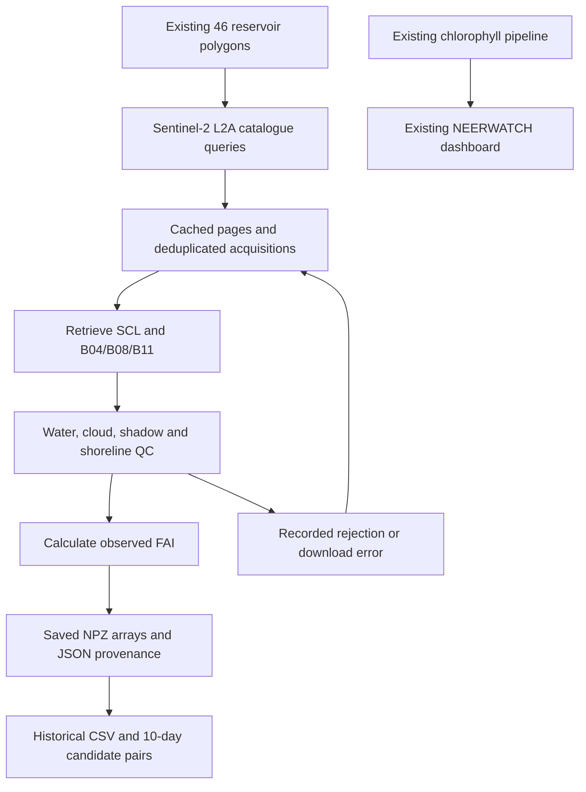

# Implemented architecture — acquisition stage

The observed-FAI history branch is running and incomplete. A trained regressor and FAI dashboard integration are not yet implemented and are intentionally absent from this diagram.
